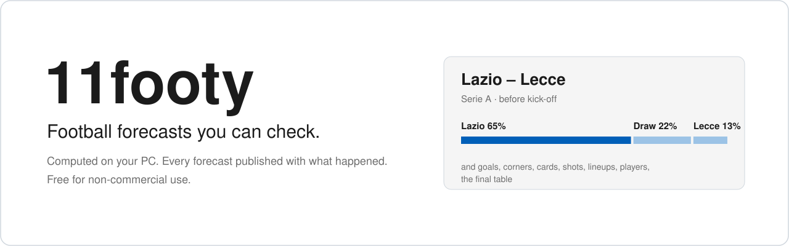
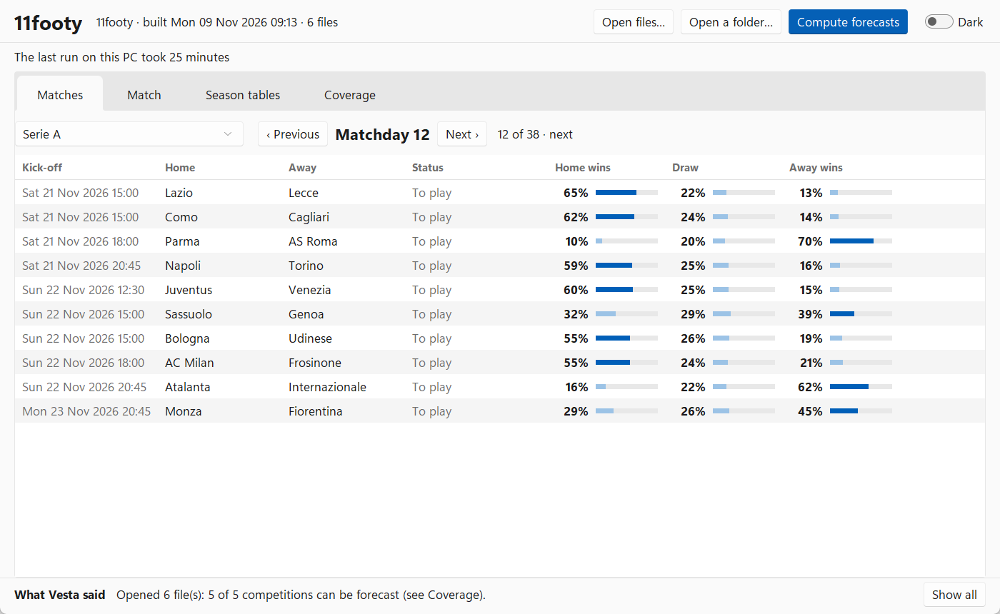
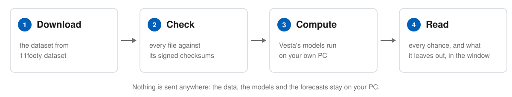
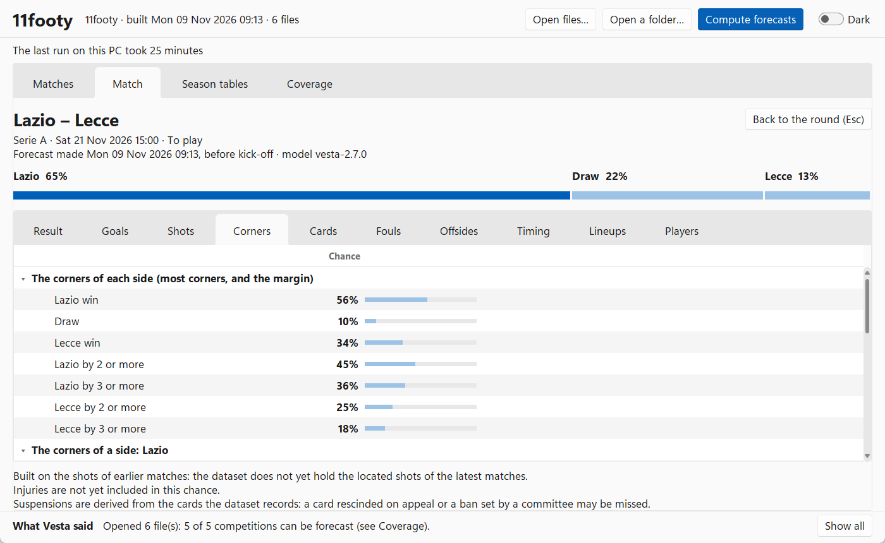

<picture>
  <source media="(prefers-color-scheme: dark)" srcset="assets/cover-dark.svg">
  
</picture>

**Football (soccer) forecasts you can check.** Vesta, the family of models in this repository,
computes pre-match probabilities on your own PC. Every forecast of the current Vesta is
published raw, with what happened beside it.

What it forecasts, from 11footy's dataset:
- **The five top leagues** (Premier League, La Liga, Serie A, Bundesliga, Ligue 1): the result,
  the score, goals, both teams to score, corners, cards, shots, fouls, offsides, when the goals
  come, the lineups, each player's goals, shots and cards, and the final table.
- **The second divisions** (Championship, Segunda División, Serie B, 2. Bundesliga, Ligue 2):
  the result, the score and goals; no chances of the final places.
- **The European cups** (Champions League, Europa League, Conference League): the result, the
  score, goals, both teams to score, corners, cards, shots, fouls and offsides.
- **National teams:** the result, the score, goals and both teams to score, from a model that
  did not pass Vesta's tests. The window marks every one of these forecasts as not validated.

The same match can get slightly different chances from one league's file than from the whole
dataset: with less history beside it, Vesta's models see fewer matches when they fit.

<picture>
  <source media="(prefers-color-scheme: dark)" srcset="assets/window-matches-dark.png">
  
</picture>

- A desktop window for Windows, macOS and Linux, light or dark.
- A free dataset, refreshed after each round: [11footy-dataset][dataset-repo].
- No account and no website: nothing is sent anywhere, and everything stays beside the file you
  open.
- Free for non-commercial use; code and data public.

## How well does it do?

When Vesta says 60%, how often does it happen? Every pre-match forecast of the current Vesta is
logged before kick-off and published with the result, hits and misses alike: nothing is selected
or removed.

Two measures say how good a forecast is:
- **Log loss** scores each forecast by the chance it gave to what then happened: the lower, the
  better. For the match result, saying one third to home, draw and away every time scores 1.099.
- **Calibration** checks the chances themselves: of the events Vesta gave 30%, about 3 in 10
  should happen.

### The blind test

Models are tested blind, on seasons they were not built on: here the two seasons 2024-25 and
2025-26 of the five top leagues, 3,504 matches, each forecast made from the matches before it
only. Vesta has two match models. The **full model** reads the shots' expected goals and
forecasts the five top leagues of 11footy's dataset; the **basic model** reads results only
and forecasts the second divisions and any dataset without located shots.

| Log loss (lower is better) | Full model | Basic model | Each league's past shares |
|---|---|---|---|
| The match result | **0.984** | 0.993 | 1.077 |
| The score | **2.876** | 2.894 | 3.003 |
| Each team's goals | **1.401** | 1.410 | 1.460 |
| Both teams score | **0.686** | 0.689 | 0.688 |

Both models beat the past shares on the result, the score and each team's goals. On both teams
to score, the full model is level with them within the noise and the basic model slightly
worse, so the basic model does not forecast it. The full model is the sharper: its result
chances were off by 0.87 points on average (calibration error), the basic model's by 0.75. Its
rare chances of 90% or more were too confident (11 such forecasts, 6 of them right), so it did
not pass the strict calibration part of the blind test, which the basic model passed. The
published record below shows how its chances hold up from here.

### The forecasts published so far

<!-- track-record:start -->

From 28 October 2026 to 8 November 2026, updated every week:

- **154 matches** played, **199,160 probabilities** checked against what happened.
- The match result: log loss **0.913**; Vesta's likeliest outcome happened in **62%** of the matches.

| Vesta said | On average | It happened | Probabilities |
|---|---|---|---|
| 0% to 10% | 2% | 2% | 106,263 |
| 10% to 20% | 15% | 14% | 16,500 |
| 20% to 30% | 25% | 24% | 11,591 |
| 30% to 40% | 35% | 35% | 8,458 |
| 40% to 50% | 45% | 45% | 8,264 |
| 50% to 60% | 55% | 55% | 7,740 |
| 60% to 70% | 65% | 65% | 6,845 |
| 70% to 80% | 75% | 78% | 7,358 |
| 80% to 90% | 85% | 87% | 9,191 |
| 90% to 100% | 97% | 96% | 16,950 |

Every family's own calibration is in [`track-record/calibration.csv`](track-record/calibration.csv).

<!-- track-record:end -->

The `track-record/` folder of this repository explains every column and holds each family's
calibration. The full record is attached to each [dataset release][release] as
`track-record.db` and `track-record.csv.gz`.

## How it works

<picture>
  <source media="(prefers-color-scheme: dark)" srcset="assets/how-it-works-dark.svg">
  
</picture>

## Start

1. Install [uv](https://docs.astral.sh/uv/). It installs Python 3.12 and everything else the
   window needs, Tk included.
   - **Windows**, in PowerShell:
     `powershell -ExecutionPolicy ByPass -c "irm https://astral.sh/uv/install.ps1 | iex"`
   - **macOS and Linux**, in a terminal: `curl -LsSf https://astral.sh/uv/install.sh | sh`
2. Download this repository (**Code → Download ZIP**, then unpack it; or `git clone`).
3. Start the window:
   - **Windows:** double-click `11footy.bat`.
   - **macOS:** double-click `11footy.command`. The first time, macOS blocks a script
     downloaded from the internet: right-click it, choose **Open**, then **Open** again.
   - **Linux:** run `./11footy.sh` (or let your file manager run it).

   The first start installs Python and the libraries, then the window opens.
4. From the [latest release of 11footy-dataset][release], download into one folder
   `SHA256SUMS`, `SHA256SUMS.sig` and either the whole dataset (`11footy.db.xz`, about 270 MB)
   or the files you want (one per league, per European cup, and `nations`) together with
   `players.db.xz`.
5. In the window, press **Open a folder…** and choose that folder (or **Open files…** and choose
   the files), then **Compute forecasts**.

The window checks every file against `SHA256SUMS` and unpacks it beside itself: leave about
1.5 GB free beside the download. If the window cannot start, it says why, in a message or in
the terminal, and keeps the details in `start-failure.log` in your user folder for
applications.

On Linux, Tk needs the desktop's X11 libraries, which every desktop has. The signature check
of the dataset uses `ssh-keygen` from the `openssh-client` package; without it the window says
the files are listed but not signed.

### How long it takes

Approximate times on an ordinary laptop, on Windows. They depend on the PC and on what else it
is doing: the longer ends were measured with other programs running.

| Step | Time |
|---|---|
| First start: Python 3.12 and the libraries (157 MB) | about 40 seconds, once |
| Open the whole dataset: check and unpack | about a minute |
| Compute forecasts, whole dataset | about 10 to 30 minutes the first time (Vesta builds a cache beside the dataset), about 3 to 8 minutes afterwards |
| Compute forecasts, one league with `players.db` | about 2 to 5 minutes |

## The window

<picture>
  <source media="(prefers-color-scheme: dark)" srcset="assets/window-match-dark.png">
  
</picture>

Four screens:
- **Matches:** every matchday of the season, opened on the current one (the one under way, or
  the next once every match of the last one is finished); Previous and Next, or the left and
  right arrows, move between them. Past matchdays show the results beside the forecast made
  before kick-off; the next one its forecasts; later ones their fixtures, forecast when each
  becomes the next.
- **Match:** everything forecast for one match, with what each forecast leaves out.
- **Season tables:** the table, and each team's chance of every final place, from the champion
  to the bottom three.
- **Coverage:** each file and how it was checked; each competition and what Vesta can forecast
  for it.

Enter opens a match and Esc goes back. The window remembers the last dataset, light or dark,
and its size and place.

## What it is not

- **Probabilities, nothing more.** For fans and analysts who want to know how likely each
  outcome is.
- **Not live.** It forecasts before kick-off only; a match in play is not followed.
- **Injuries are not included yet.** Suspensions come from the cards the dataset records. Every
  forecast says what it leaves out, beside it in the window.

## Your own dataset

Vesta reads any dataset in the Vesta data format: one SQLite file with the tables and columns
described in [`docs/VESTA_DATA_FORMAT.md`](docs/VESTA_DATA_FORMAT.md); the
[dataset's README][dataset-repo] draws them in one picture. Adapt your data to it,
then open the file in the window as above. Vesta checks what the file holds and forecasts what
it can: the **Coverage** screen lists each competition, and why one is not forecast (for
example, a cup whose leagues are missing). Forecasts on a dataset other than 11footy's say so:
no blind test of Vesta covers it.

## Licence

The code is under the [PolyForm Noncommercial License 1.0.0](LICENSE); the dataset is under
CC BY-NC 4.0. Both are free for non-commercial use: personal, research, teaching and the like.

## Contact and contributing

Questions, ideas and problems: [Issues](../../issues) and [Discussions](../../discussions).
To contribute, see [`CONTRIBUTING.md`](CONTRIBUTING.md); for a security problem,
[`SECURITY.md`](SECURITY.md).

[dataset-repo]: https://github.com/fm-devlab/11footy-dataset
[release]: https://github.com/fm-devlab/11footy-dataset/releases/latest
